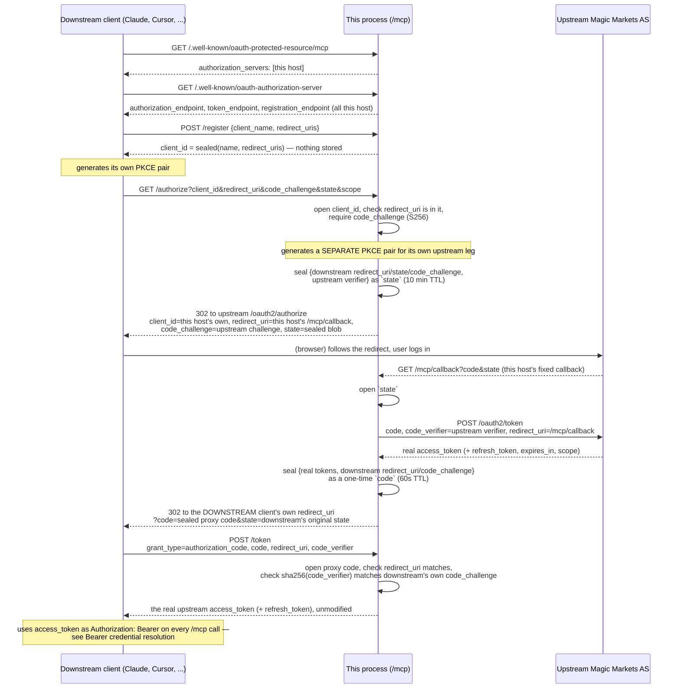
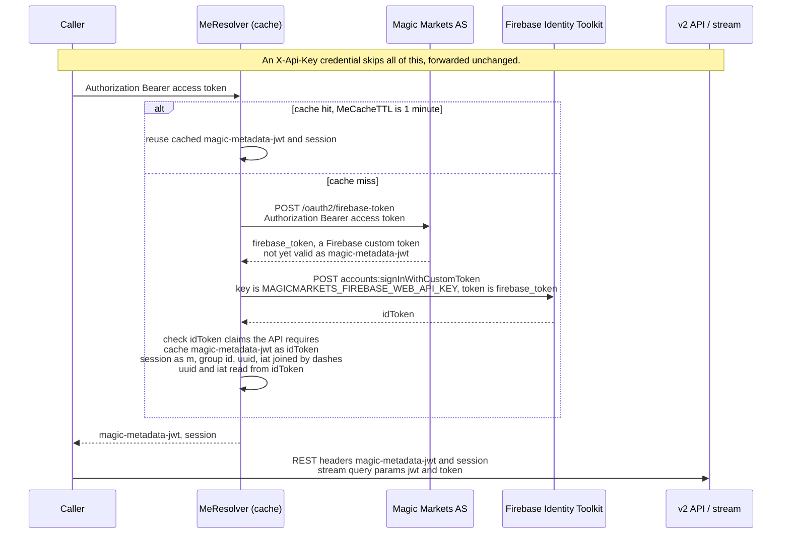

# OAuth

This process is never the Authorization Server of record — the real Magic
Markets AS (`MAGICMARKETS_OAUTH_ISSUER`, default
`https://magicmarkets.com/api/auth`) is. Two distinct things happen under the
name "OAuth" here, and they run at different times for different reasons:

- **[The MCP OAuth proxy](#the-mcp-oauth-proxy)** — `magicmarkets mcp --http`
  pretends to be an Authorization Server to a downstream MCP client (Claude,
  Cursor, ...) so that client can register and log in without ever being
  allowlisted upstream. This runs once, at connection time, and ends the
  moment the downstream client has a token.
- **[Bearer credential resolution](#bearer-credential-resolution)** — turning
  the OAuth access token that flow hands out into the `magic-metadata-jwt` /
  `session` pair the v2 API and `/v2/stream` actually require. This runs on
  *every* HTTP MCP tool call that authenticates with `Authorization: Bearer`.
  The CLI and stdio MCP do not accept an OAuth access token; they use
  `MAGICMARKETS_API_KEY`.

Nothing here replaces or re-implements Magic Markets' own authorization
logic. This process checks PKCE, `redirect_uri`, and expiry on state *it
minted itself* so its own stateless design holds together across replicas —
see [Design: no server-side session state](#design-no-server-side-session-state).
Whether a given login is authorized at all is entirely the upstream AS's
decision.

## The MCP OAuth proxy

Relevant code: [`internal/mcpserver/oauth.go`](../internal/mcpserver/oauth.go),
[`internal/mcpserver/oauthcrypto.go`](../internal/mcpserver/oauthcrypto.go).

### Why a proxy at all

A remote MCP client discovers OAuth by reading
`/.well-known/oauth-protected-resource` from the MCP resource
(`https://magicmarkets.com/mcp`) and then
`/.well-known/oauth-authorization-server` from whatever issuer that names.
Dynamic Client Registration ([RFC 7591](https://www.rfc-editor.org/rfc/rfc7591))
lets that client self-register a `redirect_uri` of its own choosing — but the
real Magic Markets AS only allowlists a small, fixed set of pre-registered
`redirect_uri`s (`MAGICMARKETS_OAUTH_CLIENT_ID`'s registration). Claude's
`redirect_uri` is never on that list, and never will be: it's a different one
for every client and every install.

So this process names *itself* as the Authorization Server in protected-
resource metadata. DCR, `/authorize`, and `/token` all land here first. This
host is the one thing that *is* pre-registered upstream (its own fixed
`{public-url}/mcp/callback`), so it can complete a real login against the
upstream AS and then had the resulting tokens — unmodified — back to whatever
client asked, regardless of that client's own `redirect_uri`.

### Endpoints

| Path (also under `/mcp/...`) | Upstream equivalent | What happens here |
| --- | --- | --- |
| `GET /.well-known/oauth-protected-resource[/mcp]` | — | Names this host as the issuer for `https://.../mcp` |
| `GET /.well-known/oauth-authorization-server`, `GET /.well-known/openid-configuration` | `GET {issuer}/.well-known/oauth-authorization-server` | Advertises this host's own `/register`, `/authorize`, `/token` |
| `POST /register` | `POST {issuer}/oauth2/register` | RFC 7591 DCR — see [Dynamic Client Registration](#dynamic-client-registration) |
| `GET\|POST /authorize` | `GET {issuer}/oauth2/authorize` | Validates the downstream request, starts this process's own upstream PKCE login |
| `GET /callback` | — (upstream redirects here) | The one fixed `redirect_uri` this process ever presents upstream |
| `POST /token` | `POST {issuer}/oauth2/token` | `authorization_code`: redeemed entirely locally. `refresh_token`: proxied straight through — see [Refreshing](#refreshing) |

### Walking through a login

Two separate PKCE pairs are in play and it's easy to mix them up: the
**downstream** pair is the client's own, verified by this process against the
`code_challenge` it received in `/authorize`. The **upstream** pair is
generated by this process itself in `serveAuthorize` and verified by the real
AS. Neither verifier ever leaves the party that generated it.

### Dynamic Client Registration

`POST /register` answers with a `client_id` that is not looked up anywhere —
it's the registration (`client_name` + `redirect_uris`) sealed into an
opaque, authenticated token (AES-256-GCM, keyed by
`MAGICMARKETS_OAUTH_PROXY_SECRET`). `/authorize` later "looks up" a
registration by opening that same token. This is what makes DCR work without
a database: any replica of a multi-replica deployment can validate a
`client_id` it never saw minted, as long as it holds the same secret. The
trade-off is that a `client_id` never expires on its own — see
[Design: no server-side session state](#design-no-server-side-session-state).

### Refreshing

A downstream client that received a `refresh_token` from the
`authorization_code` exchange can later `POST /token` with
`grant_type=refresh_token`. This proxies straight through to
`{issuer}/oauth2/token`, substituting this process's own `client_id` — no
sealed state is involved, since the downstream client already holds the real
upstream `refresh_token` verbatim.

**This is end-to-end plumbing on our side, not a confirmed upstream
capability.** As of this writing the upstream token endpoint's documented
contract covers `grant_type=authorization_code` only; if it doesn't also
implement `refresh_token`, a refresh attempt here surfaces whatever error the
upstream AS returns (relayed unchanged), and the downstream client's only
recourse is to run the full authorization flow again once its ~1-hour token
expires. Confirm current upstream support before relying on refresh in a
long-lived integration.

### Design: no server-side session state

The hosted deployment runs multiple replicas with no session affinity, and
the login dance crosses several requests that aren't guaranteed to land on
the same one — the browser hits `/authorize` then `/callback`, and the
downstream client hits `/token` from a different network path entirely. So
this process keeps no server-side session store at all: every value it hands
out (a DCR `client_id`, the `state` sent upstream, the one-time proxy code
returned downstream) is a sealed, self-contained blob any replica can verify
on its own — as long as every replica shares
`MAGICMARKETS_OAUTH_PROXY_SECRET`.

**Known limitations of this design:**

- **A redeemed proxy code is not tracked as spent.** It stays valid for its
  full 60-second TTL rather than being invalidated after first use, because
  there's no shared store to mark it spent in. PKCE still protects it: the
  code alone (which may end up in a redirect URL, logs, or browser history)
  is useless without the downstream client's own verifier, which never
  leaves that client.
- **A DCR `client_id` never expires.** It's valid for as long as
  `MAGICMARKETS_OAUTH_PROXY_SECRET` is unchanged. Rotating that secret is the
  only way to invalidate outstanding registrations.
- **Without `MAGICMARKETS_OAUTH_PROXY_SECRET` set**, a random secret is
  generated per process at startup, which only works for a single replica —
  a login that starts on one replica and completes on another fails to
  decode. `ServeHTTP` logs a warning in this case. Fine for a single-replica
  deployment; required for anything else.

### Configuration

| Variable / flag | Required for | Effect |
| --- | --- | --- |
| `--public-url` / `MAGICMARKETS_MCP_PUBLIC_URL` | OAuth metadata, the fixed callback | Externally-reachable base this process advertises itself under; also the resource identified by OAuth metadata |
| `MAGICMARKETS_OAUTH_ISSUER` | Both flows | The upstream Magic Markets AS `/authorize` and `/token` proxy to |
| `MAGICMARKETS_OAUTH_CLIENT_ID` | The proxy's upstream leg | A client pre-registered with the upstream AS whose `redirect_uris` allowlist includes *this host's* `{public-url}/mcp/callback` — never a downstream client's own `redirect_uri` |
| `MAGICMARKETS_OAUTH_PROXY_SECRET` | Every replica of a multi-replica deployment | Seals/opens all proxy state — see above |

## Bearer credential resolution

Relevant code: [`internal/magicmarkets/meauth.go`](../internal/magicmarkets/meauth.go),
[`internal/magicmarkets/auth.go`](../internal/magicmarkets/auth.go).

This repo targets the **public v2 API**: `https://magicmarkets.com/v2`. A
caller presents one of two credentials — `X-Api-Key`, or
`Authorization: Bearer` with an OAuth access token — but only the API key is
what actually goes out on the wire. A Bearer token is not accepted by the v2 API
or `/v2/stream` as-is; it must first be resolved, in two hops, to the
`magic-metadata-jwt` / `session` pair those endpoints require:

1. `POST {issuer}/oauth2/firebase-token` (`Authorization: Bearer <access
   token>`) mints a **Firebase custom token** carrying the player's real
   entitlements.
2. A Firebase custom token is not itself a valid ID token — Magic Markets'
   own OAuth integration guide for MCP server implementers is explicit that a
   custom token must be redeemed for a Firebase **ID token** before it's
   usable. This process does that redemption itself, calling Google's
   Identity Toolkit REST API directly —
   `POST https://identitytoolkit.googleapis.com/v1/accounts:signInWithCustomToken?key=<MAGICMARKETS_FIREBASE_WEB_API_KEY>`
   — and uses the returned `idToken` as `magic-metadata-jwt`.

`GET {issuer}/me` is *not* used for any of this: it's guarded by Firebase
ID-token verification, which the self-signed OAuth access token never
satisfies. `internal/magicmarkets.MeResolver` does both hops and caches the
result for `MeCacheTTL` (1 minute); both `internal/mcpserver` and the
CLI/stdio path go through the same client, so both get it automatically.

**Why `MAGICMARKETS_FIREBASE_WEB_API_KEY` exists:** hop 2 above is a call to
*Firebase's* Identity Toolkit API, not to any Magic Markets endpoint, and
Firebase requires a **Web API key** — scoped to the Magic Markets Firebase
project — to identify which project's custom token is being redeemed. It is
not a secret minted per-caller; it's the same project-level key any Firebase
web client already embeds client-side. It has no safe default because it's
project- and environment-specific (STG and prod are different Firebase
projects), so — like `MAGICMARKETS_SESSION_GROUP_ID` — it must be set
explicitly wherever an OAuth Bearer caller is expected, or every
Bearer-authenticated call fails.

The `session` value is `m-<MAGICMARKETS_SESSION_GROUP_ID>-<uuid>-<iat>`, with
`uuid` (lowercased) and `iat` read off the redeemed ID token — **without
verifying its signature**; the API does that. The API binds a magic session to
the `magic-metadata-jwt` it travels with: it rejects a session id whose uuid or
iat differs from the JWT's. Before sending, the resolver also checks the claims
the API requires of a magic customer — `uuid`,
`tenant == "magicmarkets"`, `iat`, `ccy_code` absent or `USDT`,
`commission_rate` absent or null — so a bad token fails naming the claim
instead of as a bare 401.

### Known limitations

- **This process redeems a Firebase custom token for an ID token itself,
  instead of that being Magic Markets' problem.** `POST
  /oauth2/firebase-token` could just as easily call `signInWithCustomToken`
  server-side and hand back a ready-to-use ID token — sparing every MCP
  server implementer (not just this one) from needing
  `MAGICMARKETS_FIREBASE_WEB_API_KEY`, a direct dependency on Google's
  Identity Toolkit endpoint, and knowledge of the custom-token/ID-token
  distinction at all. This is a client-side workaround for a gap in the
  Authorization Server's contract, not the intended end state — revisit
  once/if `/oauth2/firebase-token` returns an ID token (or the v2 API accepts
  a custom token directly).
- **The cache is in-process, not shared.** `MeResolver`'s cache is a
  per-replica LRU, not the sealed, replica-independent state the MCP OAuth
  proxy uses for its own state. On a hosted, multi-replica deployment, a
  request routed to a different pod than a prior one just pays for one extra
  exchange (now two calls: `/oauth2/firebase-token` and
  `signInWithCustomToken`) on a cache miss — it does not fail, unlike an
  un-shared `MAGICMARKETS_OAUTH_PROXY_SECRET` would.
- **The TTL and cache size are fixed consts**, not environment variables
  (`MeCacheTTL` = 1 minute; a size of 4096 distinct access tokens) — see
  `internal/magicmarkets/meauth.go`.
- **`MAGICMARKETS_SESSION_GROUP_ID` and `MAGICMARKETS_FIREBASE_WEB_API_KEY`
  have no safe default** and differ per environment — both must be set
  explicitly wherever an OAuth Bearer caller is expected, or every
  Bearer-authenticated call fails.
- **No proactive token refresh.** Resolution is retried on every cache miss,
  but nothing refreshes an access token before it expires — an expired token
  surfaces as a failed exchange (and thus a failed tool call), the same as
  any other invalid credential. See also [Refreshing](#refreshing) above.

## Trust boundary

Everything in this file is this process's own bookkeeping — PKCE, sealed
state, TTLs, caching. None of it is where "is this login allowed" gets
decided; that decision, and the security properties of the login itself, are
entirely the upstream Magic Markets Authorization Server's. If you're
reasoning about this flow's security properties end to end (not just this
process's handling of it), the upstream AS is the part to review.
